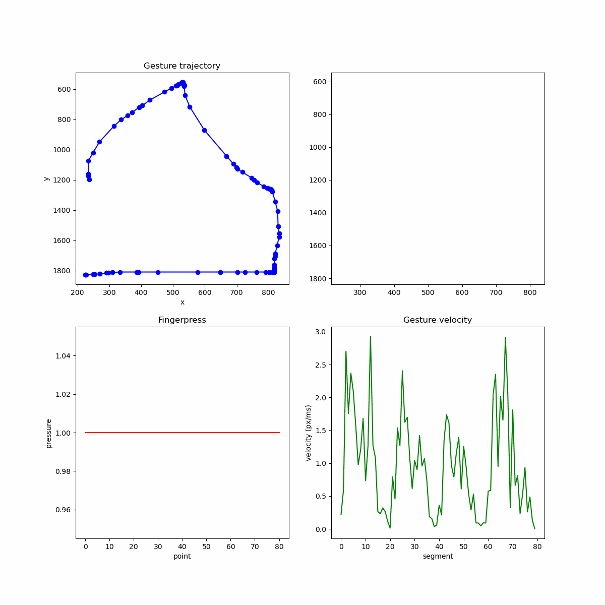

# JustGest


## How it works?
- run android_app in AndroidStudio emulator
- draw whatever you want!
  

- when you lift your finger (or mouse in emulator case) your drawing will be saved as .json file 
- you can find your .json in in View --> Tool Windows --> Device Explorer `/storage/emulated/0/Android/data/com.example.android_app/files/gestures/data`
- copy and paste it to project /data dir
- analyze it with test.py by changing line: ```with open("data/gesture_1761839901287.json") as f:```


